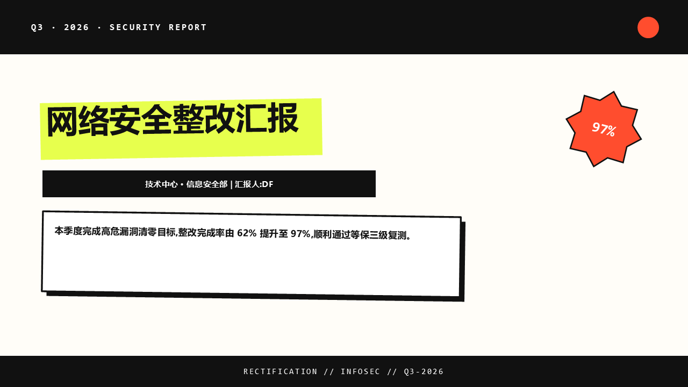
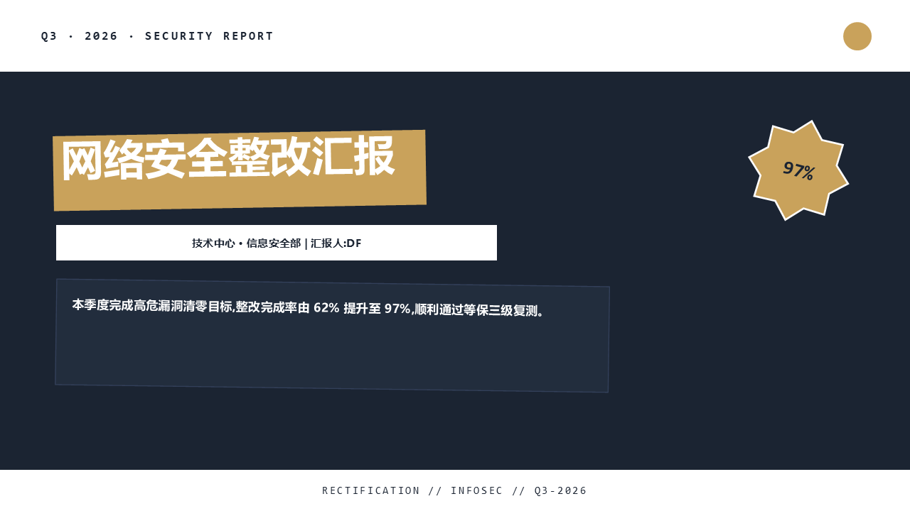
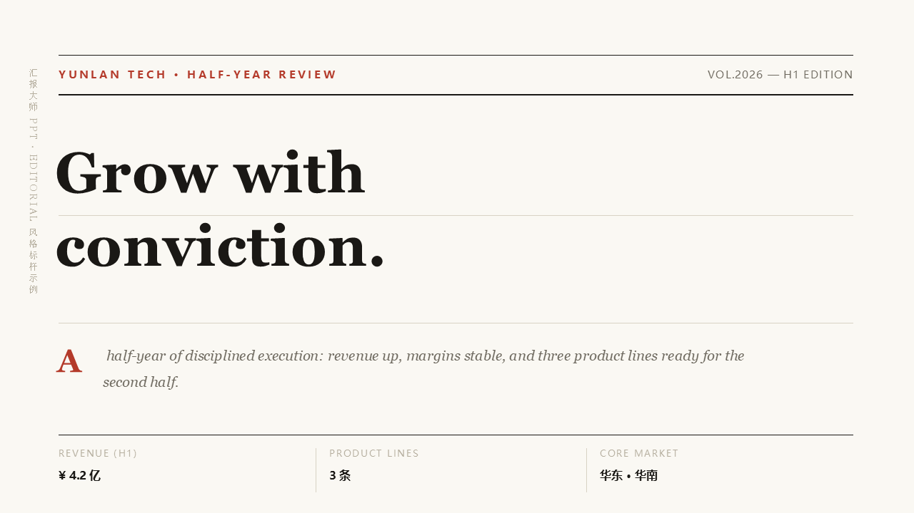

<div align="center">


# 汇报大师 PPT · huibao-ppt

**把汇报内容变成一份零翻车、有性格、可交互的原生可编辑 PPTX。**

[](https://github.com/DF-Guan/huibao-ppt/actions/workflows/ci.yml)
[](CHANGELOG.md)
[](LICENSE)
[](styles/)
[](references/page-archetypes.md)

</div>

---

## 它解决什么

AI 做 PPT 的三大绝症:**丑得千篇一律**(模板脸)、**错得防不胜防**(错位/溢出/黑底)、
**讲的时候张不开嘴**(没有口播)。本 skill 用一套"心法 + 引擎 + 护栏"的体系,让用户
只说一句话,就能得到一份**好看、耐看、能讲**的汇报。

## 三套风格,一键换肤

| 风格 | 气质 | 适合 |
|---|---|---|
| `brutal` 新野兽派 | 粗黑描边、硬投影、酸性黄、张扬 | 内部汇报、年轻团队 |
| `dark_premium` 深色高级风 | 藏青底、黄铜金、克制高级 | 客户提案、海外汇报、高端产品 |
| `editorial` 杂志编辑风 | 衬线大标题、不对称分栏、反色焦点格 | 品牌提案、年度回顾、研究报告 |

<p>
  
  
  
</p>

更多样张:`docs/`(封面 / 数据页 / 报道页)

## 核心能力

- **23 种版式**:封面、目录、数据、对比、条目、结尾、原生图表、照片墙、logo 墙、
  组织架构、时间线、场景大图、编号图组、错位叠卡、自由版、金句页、章节页、
  杂志三件套、报纸行情数据行、原生表格……一页一构图,拒绝八股
- **审美心法**(`references/thinking.md`):五维诊断(主次/节奏/呼吸/字体/色彩)、
  引导术(样片选美)、诊断表(症状→根因→处方)、自检八问——**规则防灾难,心法出好作品**
- **艺术字与字体系统**:中西文分离配对(Georgia/宋体/Arial Black/微软雅黑)、
  描边/渐变/竖排/斜体衬线/字距;**数字等高线自动防护**(旧式数字错位自动切字体)
- **质量三道闸**:preflight 预检(渲染前)→ LINT+错位监测(渲染中)→ 一键导出 PNG 逐页验收(渲染后)
- **交互**:可点击目录跳页、返回导航、翻页动效;**每页口播备注**
- **透明 logo 自动白底**:黑色祸根自动拦截

## 快速开始

```bash
# 1. 装依赖(隔离环境)
pip install -r requirements.txt

# 2. 用户说不上来要什么?一键出多风格样片册让 TA 翻页指认
python scripts/sample.py --title "你的主题" --lead "导语" --stats "38项,高危清零;214个,权限回收"

# 3. 写 spec(复制示例改内容),预检 + 渲染
python scripts/preflight.py examples/deck-spec.example.json
python scripts/build_deck.py examples/deck-spec.example.json 输出.pptx --style editorial

# 4. 一键导出 PNG 逐页验收
python scripts/export_preview.py 输出.pptx preview/
```

## 目录结构

```
huibao-ppt/
├── SKILL.md                      # 技能入口:四阶段工作流 + 13 条铁律
├── references/
│   ├── thinking.md               # ★ 审美心法(先读)
│   └── page-archetypes.md        # 23 版式字段契约
├── scripts/
│   ├── pptx_kit.py               # 渲染引擎(图元/艺术字/监测器/护栏)
│   ├── build_deck.py             # 页面生成器(风格驱动)
│   ├── capacity.py               # 容量预警
│   ├── preflight.py              # 渲染前预检
│   ├── sample.py                 # 样片选美工具
│   └── export_preview.py         # 一键导出 PNG
├── styles/                       # 三套风格令牌(JSON)
├── examples/                     # 可改写示例(数据均为虚构演示)
└── docs/                         # logo 与样张
```

## 环境与兼容

- Python 3.10+,依赖 `python-pptx` + `Pillow`(Windows 验收导出另需 `pywin32`)
- 输出为原生 PPTX:PowerPoint / WPS / LibreOffice 均可打开编辑
- 字体:默认使用 Windows 常见字体(微软雅黑/Arial/Georgia/宋体/Consolas),
  跨平台缺字体时会回退,交付前请 `export_preview.py` 目检

## 许可

[MIT](LICENSE) · Copyright (c) 2026 DF · 汇报大师 PPT

项目地址:https://github.com/DF-Guan/huibao-ppt

设计方法论来自公开风格资料与多轮实战评审的提炼;示例数据全部虚构,不含任何真实商业信息。
